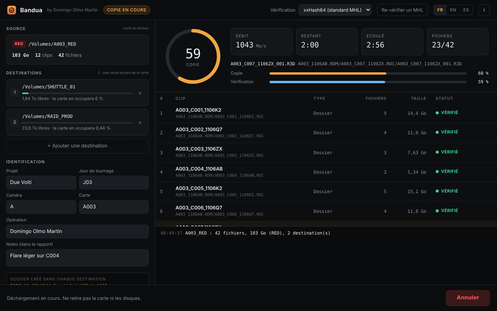
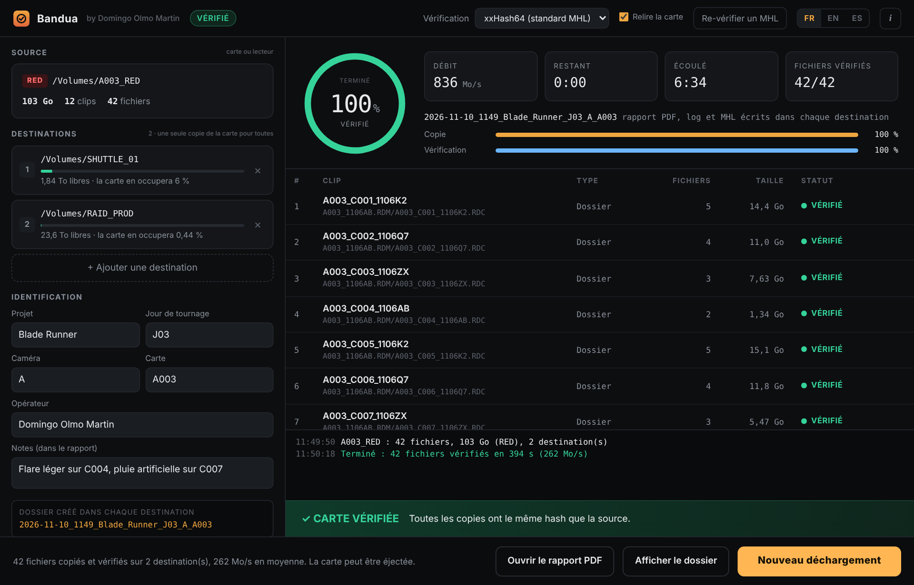
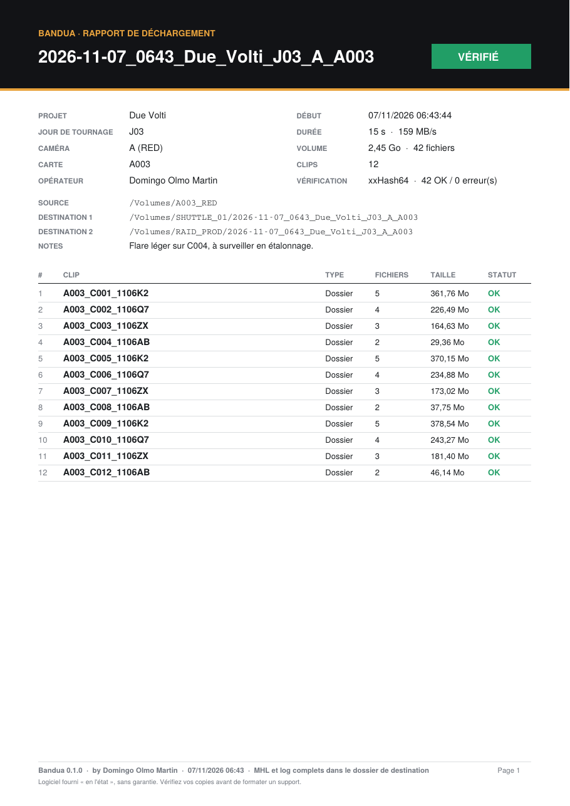

<p align="center">
  
</p>

<h1 align="center">Bandua</h1>
<p align="center"><b>by Domingo Olmo Martin</b></p>
<p align="center">
  <a href="README.md">English</a> · <b>Français</b> · <a href="README.es.md">Español</a>
</p>

Bandua décharge vos cartes caméra vers plusieurs disques en même temps, vérifie chaque copie par rapport à la source grâce à un hash, et produit un log, un MHL et un rapport PDF à transmettre au monteur ou au labo.

Gratuit, pour Windows, macOS et Linux. Interface et rapports en français, anglais et espagnol.

> Bandua est une divinité protectrice de l'ouest de la péninsule Ibérique. Ici, elle veille sur vos rushes.

<p align="center"></p>

## Télécharger

Rendez-vous sur la **[page des Releases](https://github.com/tetsujin28/bandua/releases)** et choisissez le fichier pour votre ordinateur :

| Système | Fichier |
|---|---|
| Windows (sans installation) | `Bandua_x.y.z_portable.exe` |
| Windows (installeur) | `Bandua_x.y.z_x64-setup.exe` ou `.msi` |
| macOS (Intel et Apple Silicon) | `Bandua_x.y.z_universal.dmg` |
| Linux | `.AppImage` ou `.deb` |

**Premier lancement.** L'application n'est pas encore signée, votre système affichera donc un avertissement une seule fois :
- **Windows** : cliquez sur « Informations complémentaires », puis « Exécuter quand même ».
- **macOS** : faites un clic droit sur l'application, choisissez « Ouvrir », puis confirmez.

## Ce que fait Bandua

- **Copie en une seule passe** vers 1, 2 destinations ou plus en même temps.
- **Vérifie chaque copie** en la relisant depuis le disque de destination et en comparant les hash (xxHash64 par défaut, XXH3, MD5 ou SHA-1). La relecture contourne le cache du système : c'est bien le disque qui est vérifié, pas une copie en mémoire. Un fichier ne prend son nom définitif qu'une fois vérifié.
- **Relit la carte une seconde fois** (option activée par défaut) pour repérer un lecteur de cartes, un câble ou une carte défaillant.
- **Surveille la carte pendant le déchargement** : un fichier qui change, apparaît ou disparaît fait échouer le déchargement, pour ne jamais formater une carte encore en cours d'écriture.
- **Crée un dossier daté** dans chaque destination, par exemple `2026-11-06_1633_PROJET_J03_A_A003`.
- **Copie la carte à l'identique** : RED (.RDM / .RDC), ARRI (ARRIRAW, MXF, ProRes), Blackmagic (BRAW), Sony, Canon, GoPro, DJI… sans les fichiers système parasites.
- **Reconnaît les clips** pour les lister proprement dans le rapport (un dossier .RDC RED = un clip).
- **Écrit 4 rapports** dans chaque dossier daté : un rapport PDF, un log texte, un fichier MHL (lisible par Silverstack, ShotPut, Hedge…) et un fichier JSON.
- **Re-vérifie** un dossier existant à partir de son MHL, avant de formater une carte ou de livrer un disque.
- **Contrôle l'espace libre** et vous prévient avant de commencer.
- **Bouton « Nouveau déchargement »** pour enchaîner les cartes : destinations et informations du projet sont conservées.

## Utilisation

1. Cliquez sur **Source** et sélectionnez la carte.
2. Ajoutez une ou plusieurs **destinations**.
3. Renseignez le projet, le jour de tournage, la caméra et la carte (le numéro de carte se remplit automatiquement à partir des noms de clips).
4. Cliquez sur **Lancer le déchargement**.
5. Attendez le bandeau vert **CARTE VÉRIFIÉE** avant de formater la carte.

## Captures d'écran

<table>
  <tr>
    <td width="62%"><br><sub>Carte vérifiée</sub></td>
    <td width="38%"><br><sub>Rapport PDF remis au monteur ou au labo</sub></td>
  </tr>
</table>

## Compiler depuis les sources

Nécessite [Rust](https://rustup.rs). Pas besoin de npm.

```
cargo install tauri-cli --version "^2" --locked
cd src-tauri
cargo tauri dev      # lancer
cargo tauri build    # fabriquer les installeurs
```

Chaque Release publiée fabrique automatiquement les fichiers Windows, macOS et Linux avec GitHub Actions.

Organisation du projet : `core/` (moteur de copie, hash et rapports, en Rust), `src-tauri/` (application de bureau), `ui/` (interface, HTML/CSS/JS sans framework).

## Licence et avertissement

© 2026 Domingo Olmo Martin. Distribué sous [licence MIT](LICENSE).

Bandua est fourni « en l'état », sans aucune garantie. Il vous aide à copier et vérifier vos médias mais ne remplace pas vos propres contrôles ni vos procédures de sauvegarde. L'auteur ne saurait être tenu responsable de toute perte ou corruption de données, ni de tout dommage résultant de l'utilisation du logiciel. **Ne formatez jamais une carte avant d'avoir vérifié que chaque copie est complète et lisible.**
