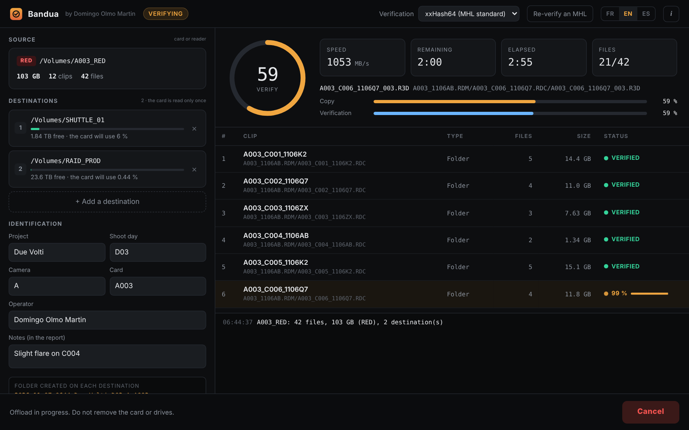
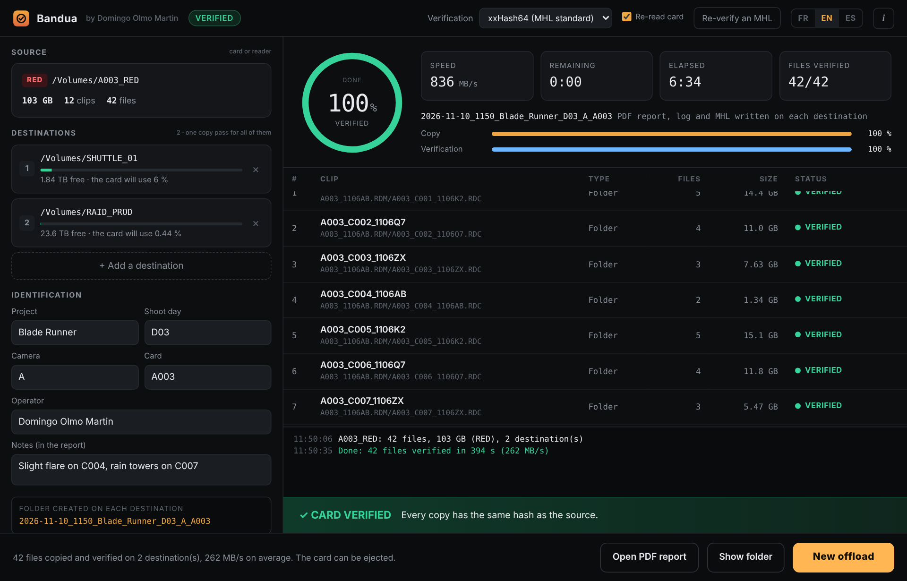
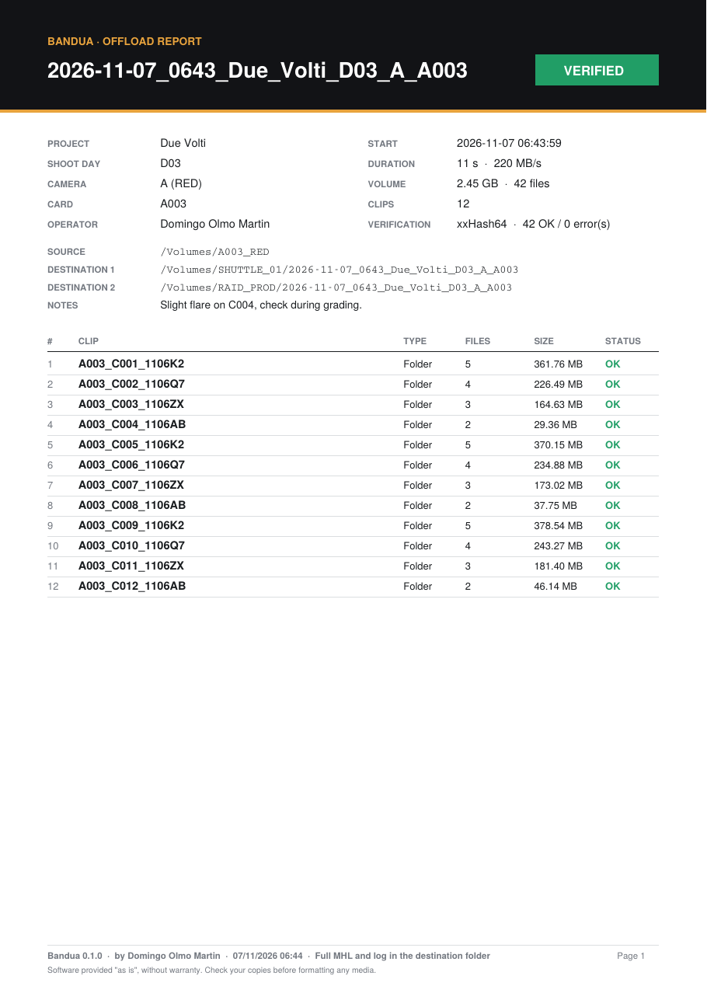

<p align="center">
  
</p>

<h1 align="center">Bandua</h1>
<p align="center"><b>by Domingo Olmo Martin</b></p>
<p align="center">
  <b>English</b> · <a href="README.fr.md">Français</a> · <a href="README.es.md">Español</a>
</p>

Bandua offloads camera cards to several drives at once, checks every copy against the source with a hash, and writes a log, an MHL and a PDF report you can hand to the editor or the lab.

Free, for Windows and macOS. Interface and reports in English, French and Spanish.

> Bandua is a protective deity of the western Iberian Peninsula. Here, it watches over your footage.

<p align="center"></p>

## Download

Go to the **[Releases page](https://github.com/tetsujin28/bandua/releases)** and pick the file for your computer:

| System | File |
|---|---|
| Windows (no install) | `Bandua_x.y.z_portable.exe` |
| Windows (installer) | `Bandua_x.y.z_x64-setup.exe` or `.msi` |
| macOS (Intel and Apple Silicon) | `Bandua_x.y.z_universal.dmg` |

**First launch.** The app is not signed yet, so your system will warn you once:
- **Windows**: click "More info", then "Run anyway".
- **macOS**: right-click the app, choose "Open", then confirm.

Your browser may also flag the download as unusual or dangerous: this is common for new, unsigned apps. Keep the file from the downloads panel, and if in doubt, check it on [VirusTotal](https://www.virustotal.com).

## What it does

- **Copies in a single pass** to 1, 2 or more destinations at the same time.
- **Verifies every copy** by reading it back from the destination drive and comparing hashes (xxHash64 by default, XXH3, MD5 or SHA-1). The read-back bypasses the system cache, so the drive itself is checked, not a copy in memory. A file only gets its final name once it is verified.
- **Reads the card a second time** (optional, on by default) to catch a faulty card reader, cable or card.
- **Watches the card during the offload**: a file that changes, appears or disappears marks the offload as failed, so you never format a card that was still being written to.
- **Creates a dated folder** on each destination, such as `2026-11-06_1633_PROJECT_D03_A_A003`.
- **Copies the card exactly as it is**: RED (.RDM / .RDC), ARRI (ARRIRAW, MXF, ProRes), Blackmagic (BRAW), Sony, Canon, GoPro, DJI… without system junk files.
- **Recognises clips** to list them properly in the report (one RED .RDC folder = one clip).
- **Writes 4 reports** in each dated folder: a PDF report, a text log, an MHL file (readable by Silverstack, ShotPut, Hedge…) and a JSON file.
- **Re-verifies** an existing folder from its MHL, before you format a card or deliver a drive: progress, a status for each clip (verified, damaged, missing), files added to the folder are flagged, and a PDF report and a log are written next to the MHL.
- **Checks free space** and warns you before starting.
- **"New offload" button** to chain cards: destinations and project info are kept.

## How to use it

1. Click **Source** and select the card.
2. Add one or more **destinations**.
3. Fill in the project, shoot day, camera and card (the card number is filled automatically from the clip names).
4. Click **Start offload**. The ring shows how much of the card is copied, then "verifying / wait" while the last checks run.
5. Wait for the ring to turn green and the **CARD VERIFIED** banner before formatting the card. Click a destination to open the copied folder.

To check a drive later (before formatting a card, or when delivering a drive), click **Re-verify an MHL** and pick the `.mhl` file in the dated folder.

## Screenshots

<table>
  <tr>
    <td width="62%"><br><sub>Card verified</sub></td>
    <td width="38%"><br><sub>PDF report given to the editor or the lab</sub></td>
  </tr>
</table>

## Build from source

Requires [Rust](https://rustup.rs). No npm needed.

```
cargo install tauri-cli --version "^2" --locked
cd src-tauri
cargo tauri dev      # run
cargo tauri build    # build installers
```

Every published Release builds the Windows and macOS files automatically with GitHub Actions.

Project layout: `core/` (copy, hash, reports engine, in Rust), `src-tauri/` (desktop app), `ui/` (interface, plain HTML/CSS/JS).

## License and disclaimer

© 2026 Domingo Olmo Martin. Released under the [MIT License](LICENSE).

Bandua is provided "as is", without any warranty. It helps you copy and verify media but does not replace your own checks and backup procedures. The author cannot be held responsible for any loss or corruption of data, or for any damage resulting from the use of the software. **Never format a card before checking that every copy is complete and readable.**
