<p align="center">
  
</p>

<h1 align="center">Bandua, manual de uso</h1>
<p align="center"><b>Versión 0.2.0 (beta) · Windows y macOS</b></p>
<p align="center">
  <a href="GUIDE.md">English</a> · <a href="GUIDE.fr.md">Français</a> · <b>Español</b>
</p>

## Índice

1. [Presentación](#1-presentación)
2. [Instalación](#2-instalación)
3. [La interfaz de un vistazo](#3-la-interfaz-de-un-vistazo)
4. [Volcar una tarjeta, paso a paso](#4-volcar-una-tarjeta-paso-a-paso)
5. [Lo que hace Bandua durante la copia](#5-lo-que-hace-bandua-durante-la-copia)
6. [Los informes](#6-los-informes)
7. [Reverificar una carpeta con su MHL](#7-reverificar-una-carpeta-con-su-mhl)
8. [Cancelación y errores](#8-cancelación-y-errores)
9. [Buenas prácticas en rodaje](#9-buenas-prácticas-en-rodaje)
10. [Preguntas frecuentes](#10-preguntas-frecuentes)
11. [Aviso y licencia](#11-aviso-y-licencia)

## 1. Presentación

Bandua vuelca tus tarjetas de cámara a uno o varios discos a la vez. Verifica cada copia frente al origen mediante un hash. Después genera un informe PDF, un log, un archivo MHL y un archivo JSON, para entregar al montador, a producción o al laboratorio.

La regla es sencilla: **nunca se formatea una tarjeta fiándose de una barra de progreso.** Bandua solo declara una tarjeta «verificada» cuando cada archivo se ha releído desde cada disco de destino y se ha comparado con el original.

Bandua es gratuito, de código abierto (licencia MIT) y no pide ni cuenta ni licencia.

## 2. Instalación

### Descargar

Los archivos están en la [página de Releases](https://github.com/tetsujin28/bandua/releases):

| Sistema | Archivo |
|---|---|
| Windows, sin instalación | `Bandua_x.y.z_portable.exe` |
| Windows, con instalador | `Bandua_x.y.z_x64-setup.exe` o `.msi` |
| macOS (Intel y Apple Silicon) | `Bandua_x.y.z_universal.dmg` |

### Primer arranque

La app aún no está firmada, así que tu sistema muestra un aviso, una sola vez:

- **Windows**: haz clic en «Más información» y luego en «Ejecutar de todas formas».
- **macOS**: haz clic derecho en la app, elige «Abrir» y confirma.

Puede que el navegador también marque la descarga como poco habitual. Es normal en una app reciente y sin firmar. Conserva el archivo desde el panel de descargas. Si tienes dudas, analízalo en [VirusTotal](https://www.virustotal.com).

### Ventana de bienvenida

En el primer arranque, Bandua muestra un aviso de exención de responsabilidad (1). Léelo y haz clic en **Lo he entendido y acepto** (2). Lo encontrarás después en **Acerca de** (el botón *i*).

<p align="center">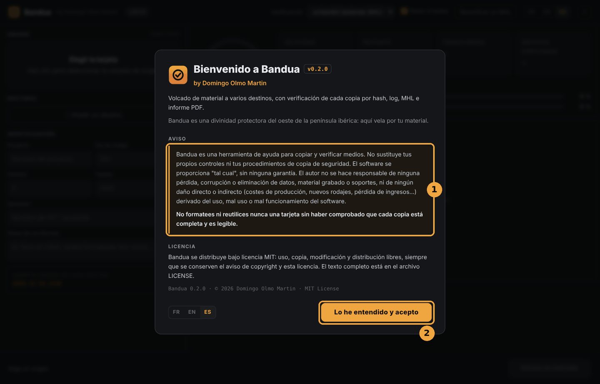</p>

## 3. La interfaz de un vistazo

<p align="center">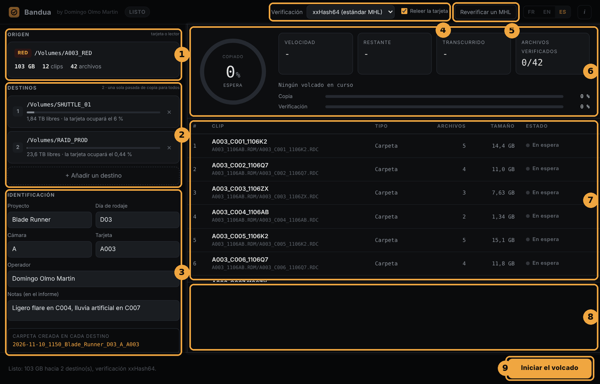</p>

1. **Origen**: la tarjeta que se va a volcar, con su marca, su tamaño y su número de clips y archivos.
2. **Destinos**: los discos que recibirán una copia, con su espacio libre.
3. **Identificación**: proyecto, día de rodaje, cámara, tarjeta, operador, notas, y la vista previa del nombre de la carpeta que se creará.
4. **Verificación**: el algoritmo de hash y la casilla **Releer la tarjeta**.
5. **Reverificar un MHL**: el control de una carpeta ya copiada (ver la sección 7).
6. **Panel**: el círculo de progreso, los contadores (*Velocidad*, *Restante*, *Transcurrido*, *Archivos verificados*), el archivo en curso y las barras de copia y verificación.
7. **Lista de clips** de la tarjeta, con el estado de cada uno.
8. **Log**: el registro en directo.
9. **Botón principal**: **Iniciar el volcado**, luego **Cancelar**, luego **Nuevo volcado** o **Reintentar esta tarjeta**. A su izquierda, un mensaje resume el estado.

Arriba, la etiqueta junto al nombre de la app indica el estado: *Listo*, *Copiando*, *Verificando*, *Verificado*, *Errores*, *Cancelado*. Los botones **FR / EN / ES** cambian el idioma de la interfaz al instante.

## 4. Volcar una tarjeta, paso a paso

### Paso 1: elegir el origen

Haz clic en el recuadro **Origen** («Elegir la tarjeta») y selecciona la tarjeta, o la carpeta que la representa.

<p align="center">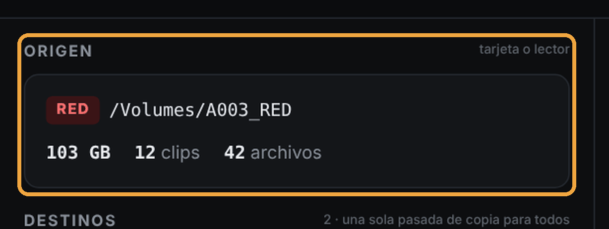</p>

Bandua analiza la tarjeta y muestra:
- la marca reconocida (RED, ARRI, Blackmagic, Sony, Canon, GoPro, DJI, o «Générique» para el resto);
- el número de clips y archivos, y el tamaño total;
- la lista de clips en la tabla de la derecha, en estado *En espera*.

Si no se reconoce ningún clip de vídeo, Bandua lo indica, pero **copia igualmente todos los archivos** de la tarjeta.

### Paso 2: añadir los destinos

Haz clic en **+ Añadir un destino** (2) y elige una carpeta en tu primer disco. Repite para cada copia que necesites (normalmente dos discos, a veces tres).

<p align="center">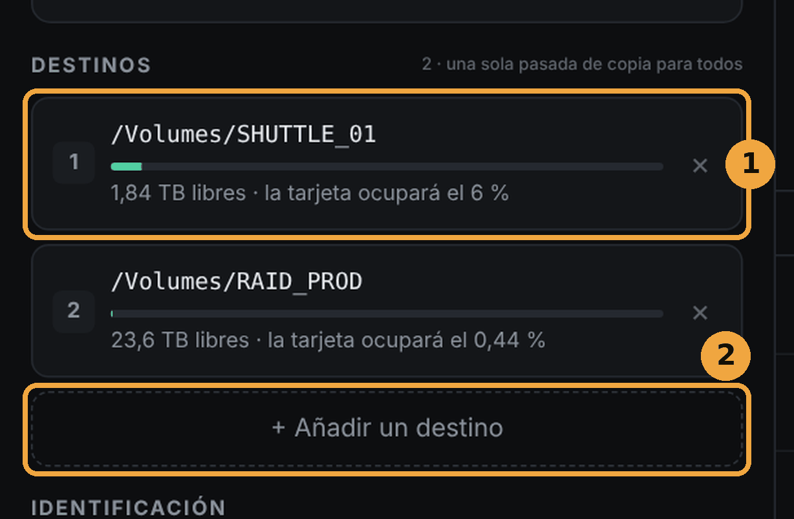</p>

Para cada destino (1), Bandua muestra:
- el espacio libre y la parte que ocupará la tarjeta;
- un indicador verde, que pasa a rojo con **ESPACIO INSUFICIENTE** si la tarjeta no cabe.

La tarjeta se lee **una sola vez** para alimentar todos los destinos. Añadir discos no multiplica el tiempo de lectura de la tarjeta.

Para quitar un destino, haz clic en la cruz de su derecha. Bandua rechaza un destino igual al origen, o una carpeta ya elegida.

### Paso 3: identificar la tarjeta

Rellena la sección **Identificación**:

| Campo | Ejemplo | Nota |
|---|---|---|
| Proyecto | Blade Runner | se conserva de una sesión a otra |
| Día de rodaje | D03 | se conserva |
| Cámara | A | se conserva; se rellena solo si está vacío |
| Tarjeta | A003 | se rellena solo a partir de los nombres de los clips |
| Operador | nombre del DIT o del ayudante | se conserva |
| Notas | «Ligero flare en C004, lluvia artificial en C007» | aparecen en el informe |

<p align="center">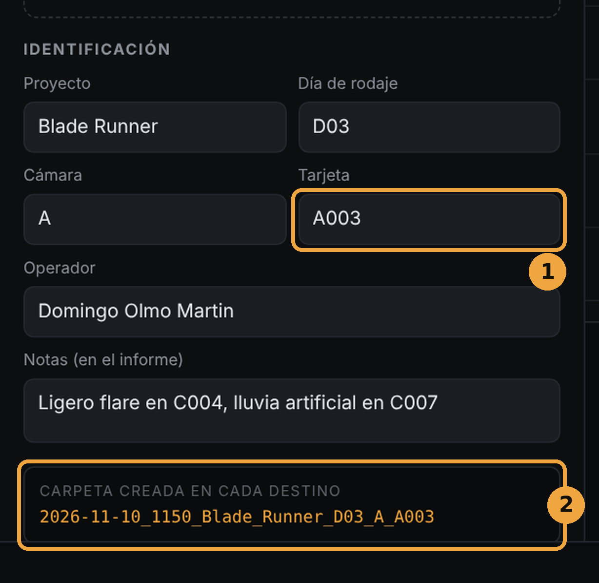</p>

El número de tarjeta (1) se deduce de los nombres de los clips (por ejemplo `A003_C001…` da la tarjeta `A003` y la cámara `A`). Compruébalo de todos modos.

Debajo de estos campos (2), Bandua muestra en directo el nombre de la carpeta que se creará en **cada** destino:

```
2026-11-10_1142_Blade_Runner_D03_A_A003
```

Es decir: fecha y hora de inicio, luego proyecto, día, cámara y tarjeta. Los campos vacíos simplemente se omiten. Si ya existe una carpeta con el mismo nombre, Bandua añade `_2`, `_3`, etc., y nunca sobrescribe nada.

### Paso 4: ajustar la verificación (opcional)

<p align="center">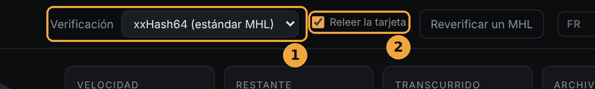</p>

- **Algoritmo** (1):
  - **xxHash64 (estándar MHL)**: la opción por defecto, recomendada. Rápida, y reconocida por los programas de postproducción.
  - **XXH3-64 (más rápido)**: aún más rápida en equipos recientes.
  - **MD5** o **SHA-1**: más lentos, solo si un laboratorio o una producción los exige.
- **Releer la tarjeta** (2): Bandua lee la tarjeta una segunda vez y compara las dos lecturas. Es más lento, pero detecta un lector de tarjetas, un cable o una tarjeta que fallan. Déjala marcada salvo urgencia real.

### Paso 5: iniciar

El mensaje de abajo (1) resume la operación, por ejemplo: *«Listo: 103 GB hacia 2 destino(s), verificación xxHash64.»* Haz clic en **Iniciar el volcado** (2).

<p align="center">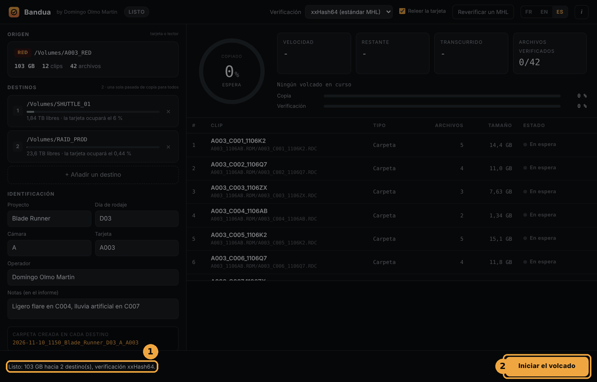</p>

Durante el volcado, **no retires ni la tarjeta ni los discos**.

<p align="center">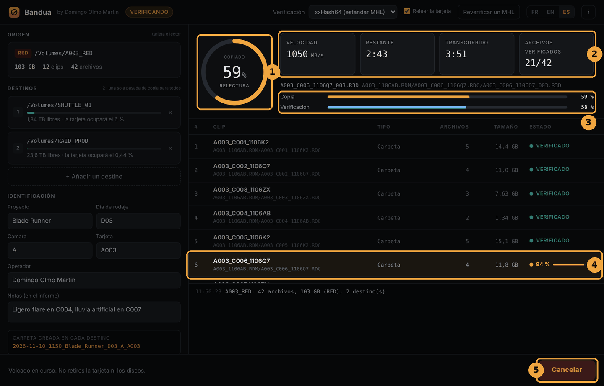</p>

1. El **círculo** indica la parte de la tarjeta ya copiada (como la barra naranja), con una palabra bajo el porcentaje: *copia*, *relectura*, *verificación* y luego *espere* durante los últimos controles.
2. Los **contadores** dan la velocidad, el tiempo restante, el tiempo transcurrido y el número de archivos verificados.
3. Las **barras** siguen por separado la copia y la verificación.
4. El **clip en curso** aparece resaltado, con su propio progreso. Después, cada clip pasa a **VERIFICADO** (verde) o **ERROR** (rojo).
5. El botón pasa a **Cancelar** (ver la sección 8).

### Paso 6: leer el resultado

<p align="center">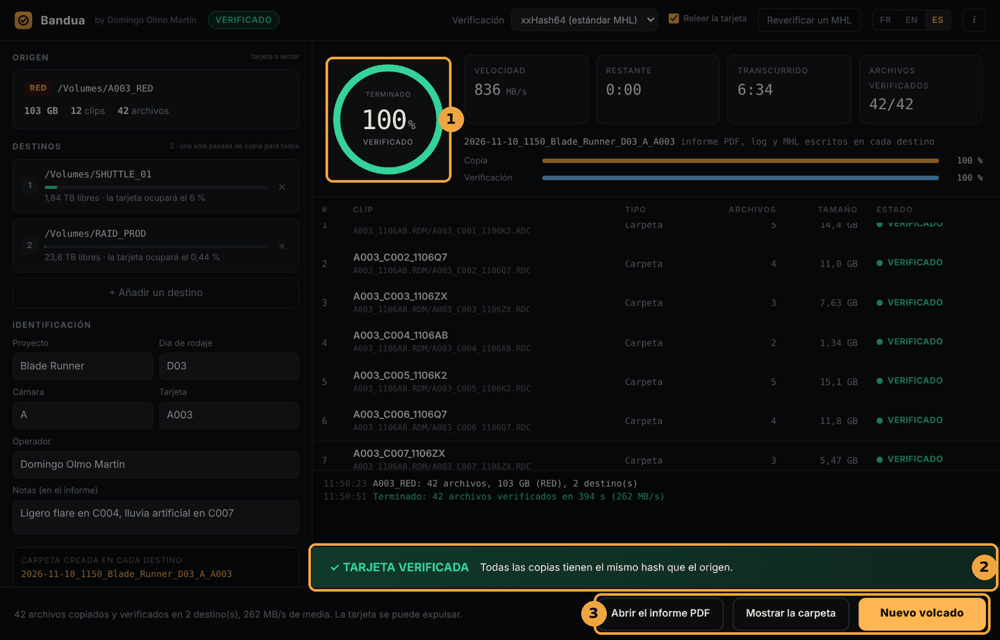</p>

**Todo está bien:**
1. el círculo pasa a verde, con la palabra *verificado*; la etiqueta de arriba indica *Verificado*;
2. la franja **✓ TARJETA VERIFICADA** aparece unos segundos: todas las copias tienen el mismo hash que el origen;
3. aparecen tres botones: **Abrir el informe PDF**, **Mostrar la carpeta** y **Nuevo volcado**.

El mensaje de abajo confirma el número de archivos y destinos y la velocidad media, e indica que la tarjeta se puede expulsar. Un clic en un destino abre directamente la carpeta copiada en ese disco.

**Algo ha fallado:** el círculo pasa a rojo y aparece la franja **✕ ERRORES DETECTADOS**. Consulta el log y la lista de clips antes de tocar la tarjeta, y **no la formatees**. Ver la sección 8.

### Paso 7: tarjeta siguiente

Haz clic en **Nuevo volcado**. Los destinos y los datos del proyecto (proyecto, día, cámara, operador) se conservan. Solo se vacían la tarjeta y las notas. Solo queda elegir la tarjeta siguiente.

## 5. Lo que hace Bandua durante la copia

Todo esto ocurre en segundo plano, sin que tengas que ajustar nada. Es lo que permite fiarse del círculo verde.

1. **Copia segura.** Cada archivo se escribe primero con un nombre temporal (`.bandua-part`). Solo recibe su nombre real **una vez verificado**. Un archivo con su nombre definitivo es, por tanto, un archivo controlado.
2. **Verificación en el disco, no en memoria.** La copia se relee desde el disco de destino evitando la caché del sistema. Se verifica de verdad el disco, y no una copia que se ha quedado en la memoria RAM. Si un volumen no permite evitar la caché, el log y el PDF lo indican.
3. **Tamaño controlado.** Un archivo demasiado corto o demasiado largo se considera un error.
4. **Doble lectura de la tarjeta** (si *Releer la tarjeta* está marcada). Si las dos lecturas difieren, las copias afectadas se marcan `.HASH_ERREUR`.
5. **Vigilancia de la tarjeta.** El tamaño y la fecha de cada archivo se controlan antes y después de su copia, y al final se hace un nuevo inventario completo de la tarjeta. Un archivo que cambia, aparece o desaparece hace fallar el volcado. Así se evita formatear una tarjeta que todavía se estaba escribiendo, o que otro programa ha modificado.
6. **Copia idéntica.** Se respeta la estructura de carpetas de la tarjeta (RED `.RDM` / `.RDC`, ARRIRAW, MXF, ProRes, BRAW, etc.), y se conservan las fechas de modificación originales.
7. **Archivos de sistema ignorados.** Los archivos que añaden los ordenadores (`.DS_Store`, `.Spotlight-V100`, `.Trashes`, `.fseventsd`, `System Volume Information`, `$RECYCLE.BIN`, `Thumbs.db`, `desktop.ini`, archivos `._` de macOS) no se copian.

## 6. Los informes

En **cada** carpeta con fecha, en **cada** destino, Bandua escribe cuatro archivos, en el idioma de la interfaz:

| Archivo | Uso |
|---|---|
| `<carpeta>_informe.pdf` (`_report.pdf` en inglés, `_rapport.pdf` en francés) | El documento que se entrega: proyecto, tarjeta, cámara, operador, notas, controles realizados, lista de clips con su estado, algoritmo, resultado. |
| `<carpeta>_log.txt` | El registro detallado, archivo por archivo, con los hash. Útil en caso de duda o de litigio. |
| `<carpeta>.mhl` | La lista de hash en formato MHL 1.1, legible por Silverstack, ShotPut Pro, Hedge… Es el archivo que permite reverificar la carpeta más adelante. |
| `<carpeta>.json` | La misma información en un formato que puede usar un script u otro programa. |

En el informe, los clips se agrupan por marca: una carpeta `.RDC` de RED cuenta como un clip, una carpeta ARRIRAW como un clip, un `.braw` como un clip, etc.

<p align="center">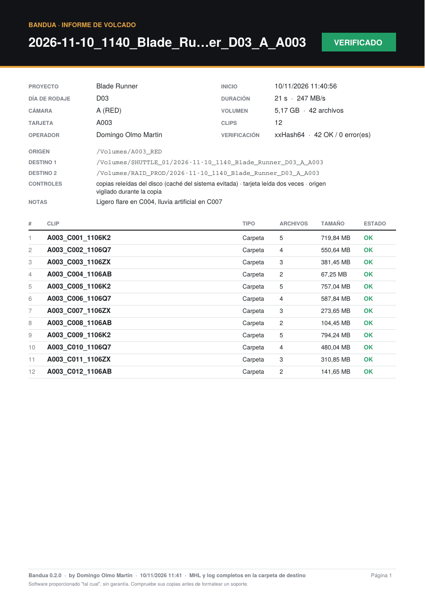</p>

## 7. Reverificar una carpeta con su MHL

Esta función sirve para comprobar que una carpeta ya copiada sigue intacta:
- antes de formatear una tarjeta, si la copia no es reciente;
- al entregar un disco al montador o al laboratorio;
- al recibir un disco, o después de un transporte.

**Procedimiento:**
1. Haz clic en **Reverificar un MHL** en la barra superior.
2. Elige el archivo `.mhl` de la carpeta con fecha.
3. Bandua relee cada archivo y lo compara con el hash guardado en el MHL. Tienes el mismo panel que en un volcado (progreso, velocidad, estado de cada clip). Puedes cancelar en cualquier momento.

<p align="center">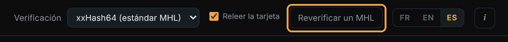</p>

**Estados posibles:**
- **VERIFICADO**: el archivo es idéntico al MHL;
- **DAÑADO**: el hash es distinto, el archivo ha cambiado o se ha corrompido;
- **FALTA**: el archivo que figura en el MHL ya no existe.

**Resultado:**
- **✓ CARPETA INTACTA**: todos los archivos son idénticos al MHL;
- si no, el clip afectado aparece marcado (1) y una franja roja (2) indica el número de archivos que faltan y dañados, con un recordatorio: no formatees la tarjeta original.

<p align="center">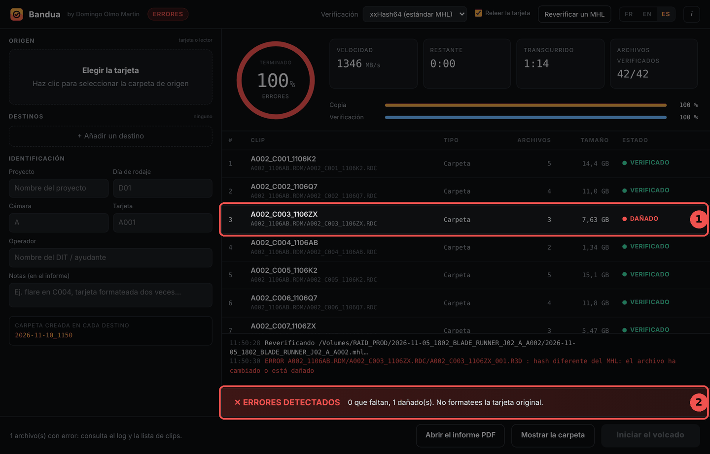</p>

Los archivos presentes en la carpeta pero **ausentes del MHL** (añadidos después) se indican en el log, pero no se verifican.

Bandua escribe junto al MHL un informe PDF y un log de reverificación, con fecha y hora, por ejemplo `<carpeta>_reverificacion_2026-11-10_143012.pdf`. El MHL original nunca se modifica.

### Controlar un MHL con Bandua MHL Companion

Quien recibe el material (montador, ayudante de montaje, laboratorio, producción) no necesita Bandua para controlar un MHL. Puede usar **[Bandua MHL Companion](https://github.com/tetsujin28/bandua-mhl-companion)**, una app gratuita y más sencilla, pensada solo para eso.

Basta con soltar la carpeta del material en su ventana: encuentra todos los MHL que contiene, relee cada archivo y lo compara con el hash guardado. Indica claramente si el material está intacto o qué clip da problemas, y puede exportar un informe de texto para enviarlo a producción o al DIT. Lee los MHL de Bandua, y también los de Silverstack, ShotPut Pro, Hedge y otros programas (MHL 1.1 y ASC MHL). Funciona en solo lectura: no copia nada y no modifica ningún archivo.

Bandua MHL Companion está disponible para Windows y macOS en la [página de Releases](https://github.com/tetsujin28/bandua-mhl-companion/releases) de su repositorio de GitHub.

## 8. Cancelación y errores

### Cancelar

Haz clic en **Cancelar** y luego en **Confirmar la cancelación** antes de tres segundos (dos clics, para evitar una cancelación accidental). Bandua se detiene limpiamente y no deja ningún archivo `.bandua-part`. La franja **✕ CANCELADO** recuerda que no hay que formatear la tarjeta.

### En caso de error

| Lo que ves | Lo que significa | Qué hacer |
|---|---|---|
| Clip en **ERROR**, archivo `.HASH_ERREUR` en el destino | La copia no coincide con el origen, o las dos lecturas de la tarjeta difieren. | Leer el log. Probar con otro lector u otro cable, y luego **Reintentar esta tarjeta**. |
| «La tarjeta cambió durante el volcado» | Se modificó, añadió o borró un archivo de la tarjeta durante la operación. | No formatear. Comprobar que ningún otro programa accede a la tarjeta, y volver a lanzarla. |
| **ESPACIO INSUFICIENTE** en un destino | La tarjeta no cabe en ese disco. | Liberar espacio o elegir otro disco. Bandua no arranca hasta que se resuelva. |
| «Lectura imposible» en el origen | La tarjeta o el lector no responden. | Volver a insertar la tarjeta, cambiar de lector. |

El botón **Reintentar esta tarjeta** vuelve a lanzar la misma tarjeta con los mismos ajustes. Se crea una carpeta nueva (con el sufijo `_2` si hace falta), y las copias defectuosas siguen siendo fáciles de identificar por su extensión `.HASH_ERREUR`.

## 9. Buenas prácticas en rodaje

- **Siempre dos copias como mínimo**, en dos discos físicamente distintos.
- **Esperar al círculo verde y a «Verificado»** antes de expulsar, y más aún antes de formatear.
- **Formatear la tarjeta en la cámara**, nunca en el ordenador.
- **Dejar «Releer la tarjeta» marcada**: la mayoría de las pérdidas vienen de un lector o un cable defectuoso, no de la propia tarjeta.
- **Rellenar las notas**: incidencias, tarjeta formateada dos veces, clip cortado… El montador te lo agradecerá.
- **Reverificar con el MHL** antes de entregar un disco.
- **No abrir la tarjeta con ningún otro programa** durante el volcado (navegador de medios, programa de montaje…).

## 10. Preguntas frecuentes

**¿Cuánto tarda?**
El tiempo de lectura de la tarjeta, más la verificación. Con «Releer la tarjeta», cuenta aproximadamente una lectura de tarjeta más. El cuello de botella suele ser el lector de tarjetas o el disco más lento.

**¿Puedo usar Bandua con una cámara que no está en la lista?**
Sí. Todas las tarjetas se copian completas. Solo la agrupación en clips del informe será más simple (marcada «Générique»).

**Mi montador usa Silverstack, ShotPut o Hedge. ¿Puede leer mis MHL?**
Sí, el MHL 1.1 con xxHash64 es el estándar que leen esos programas. También puede usar Bandua MHL Companion, gratuito.

**¿Bandua funciona en Linux?**
Por ahora no. El código sigue siendo compatible, pero no hay versión para Linux mientras no se pueda probar.

**¿Bandua envía datos por Internet?**
No. Todo ocurre en tu ordenador.

## 11. Aviso y licencia

Bandua es una herramienta de ayuda para copiar y verificar medios. No sustituye tus propios controles ni tus procedimientos de copia de seguridad. El software se proporciona «tal cual», sin ninguna garantía. El autor no se hace responsable de ninguna pérdida, corrupción o eliminación de datos, material grabado o soportes, ni de ningún daño directo o indirecto derivado del uso, mal uso o mal funcionamiento del software.

**No formatees ni reutilices nunca una tarjeta sin haber comprobado que cada copia está completa y es legible.**

© 2026 Domingo Olmo Martin. Distribuido bajo [licencia MIT](../LICENSE).
