<p align="center">
  
</p>

<h1 align="center">Bandua, mode d'emploi</h1>
<p align="center"><b>Version 0.2.0 (bêta) · Windows et macOS</b></p>
<p align="center">
  <a href="GUIDE.md">English</a> · <b>Français</b> · <a href="GUIDE.es.md">Español</a>
</p>

## Sommaire

1. [Présentation](#1-présentation)
2. [Installation](#2-installation)
3. [L'interface en un coup d'œil](#3-linterface-en-un-coup-dœil)
4. [Décharger une carte, pas à pas](#4-décharger-une-carte-pas-à-pas)
5. [Ce que Bandua fait pendant la copie](#5-ce-que-bandua-fait-pendant-la-copie)
6. [Les rapports](#6-les-rapports)
7. [Re-vérifier un dossier avec son MHL](#7-re-vérifier-un-dossier-avec-son-mhl)
8. [Annulation et erreurs](#8-annulation-et-erreurs)
9. [Bonnes pratiques de plateau](#9-bonnes-pratiques-de-plateau)
10. [Questions fréquentes](#10-questions-fréquentes)
11. [Avertissement et licence](#11-avertissement-et-licence)

## 1. Présentation

Bandua décharge vos cartes caméra vers un ou plusieurs disques en même temps. Il vérifie chaque copie par rapport à la source grâce à un hash. Il produit ensuite un rapport PDF, un log, un fichier MHL et un fichier JSON, à transmettre au monteur, à la production ou au labo.

Le principe est simple : **on ne formate jamais une carte sur la foi d'une barre de progression.** Bandua ne déclare une carte « vérifiée » qu'une fois chaque fichier relu depuis chaque disque de destination et comparé à l'original.

Bandua est gratuit, open source (licence MIT) et ne demande ni compte ni licence.

## 2. Installation

### Télécharger

Les fichiers se trouvent sur la [page des Releases](https://github.com/tetsujin28/bandua/releases) :

| Système | Fichier |
|---|---|
| Windows, sans installation | `Bandua_x.y.z_portable.exe` |
| Windows, avec installeur | `Bandua_x.y.z_x64-setup.exe` ou `.msi` |
| macOS (Intel et Apple Silicon) | `Bandua_x.y.z_universal.dmg` |

### Premier lancement

L'application n'est pas encore signée. Votre système affiche donc un avertissement, une seule fois :

- **Windows** : cliquez sur « Informations complémentaires », puis sur « Exécuter quand même ».
- **macOS** : faites un clic droit sur l'application, choisissez « Ouvrir », puis confirmez.

Il arrive aussi que le navigateur signale le téléchargement comme inhabituel. C'est courant pour une application récente qui n'est pas signée. Gardez le fichier depuis le panneau des téléchargements. En cas de doute, faites-le analyser sur [VirusTotal](https://www.virustotal.com).

### Fenêtre de bienvenue

Au premier lancement, Bandua affiche un avertissement de non-responsabilité (1). Lisez-le, puis cliquez sur **J'ai compris et j'accepte** (2). Vous le retrouverez ensuite dans **À propos** (le bouton *i*).

<p align="center">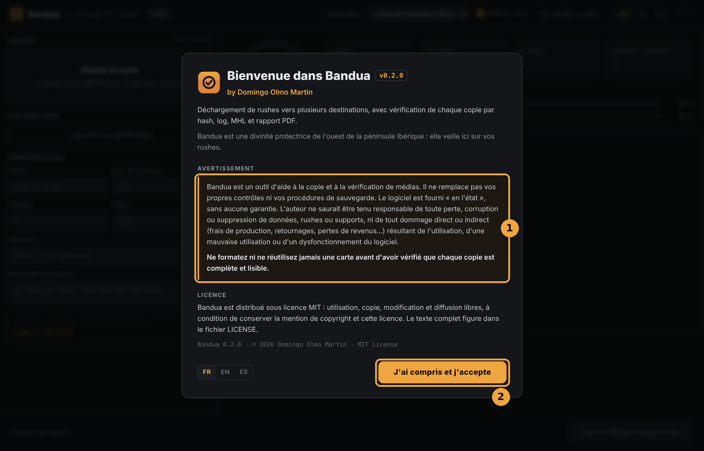</p>

## 3. L'interface en un coup d'œil

<p align="center">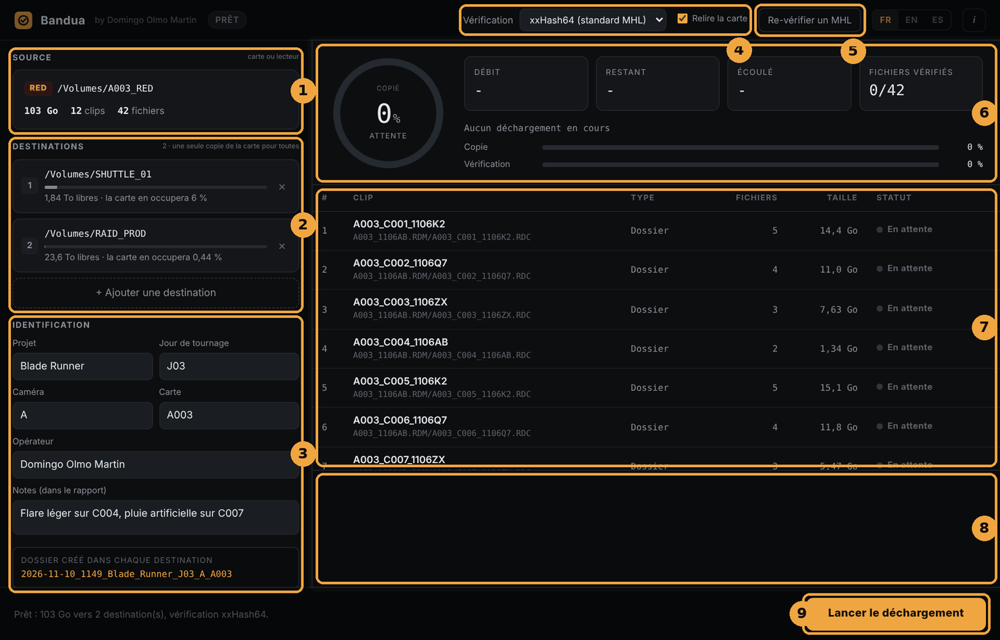</p>

1. **Source** : la carte à décharger, avec sa marque, sa taille, son nombre de clips et de fichiers.
2. **Destinations** : les disques qui recevront une copie, avec leur espace libre.
3. **Identification** : projet, jour de tournage, caméra, carte, opérateur, notes, et l'aperçu du nom du dossier qui sera créé.
4. **Vérification** : l'algorithme de hash et la case **Relire la carte**.
5. **Re-vérifier un MHL** : le contrôle d'un dossier déjà copié (voir la section 7).
6. **Tableau de bord** : le cercle de progression, les compteurs (*Débit*, *Restant*, *Écoulé*, *Fichiers vérifiés*), le fichier en cours et les barres de copie et de vérification.
7. **Liste des clips** de la carte, avec le statut de chacun.
8. **Log** : le journal en direct.
9. **Bouton principal** : **Lancer le déchargement**, puis **Annuler**, puis **Nouveau déchargement** ou **Relancer cette carte**. À sa gauche, un message résume l'état.

En haut, la pastille à côté du nom de l'application indique l'état : *Prêt*, *Copie en cours*, *Vérification*, *Vérifié*, *Erreurs*, *Annulé*. Les boutons **FR / EN / ES** changent la langue de l'interface immédiatement.

## 4. Décharger une carte, pas à pas

### Étape 1 : choisir la source

Cliquez sur le cadre **Source** (« Choisir la carte ») et sélectionnez la carte, ou le dossier qui la représente.

<p align="center">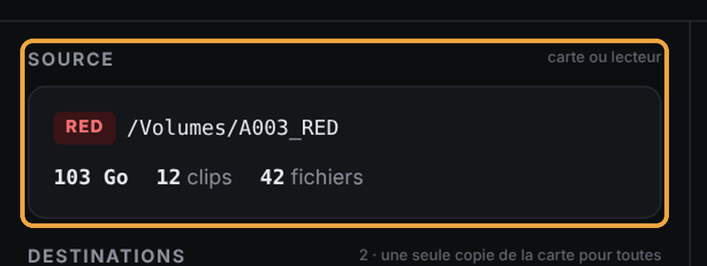</p>

Bandua analyse alors la carte et affiche :
- la marque reconnue (RED, ARRI, Blackmagic, Sony, Canon, GoPro, DJI, ou « Générique ») ;
- le nombre de clips, de fichiers, et la taille totale ;
- la liste des clips dans le tableau de droite, au statut *En attente*.

Si aucun clip vidéo n'est reconnu, Bandua l'indique, mais **copie tout de même tous les fichiers** de la carte.

### Étape 2 : ajouter les destinations

Cliquez sur **+ Ajouter une destination** (2) et choisissez un dossier sur votre premier disque. Recommencez pour chaque copie voulue (en général deux disques, parfois trois).

<p align="center">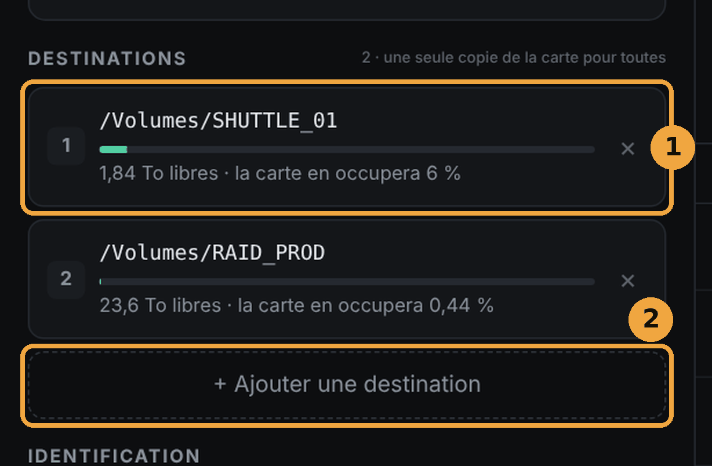</p>

Pour chaque destination (1), Bandua affiche :
- l'espace libre et la part que la carte va occuper ;
- une jauge verte, qui passe au rouge avec la mention **ESPACE INSUFFISANT** si la carte ne rentre pas.

La carte n'est lue qu'**une seule fois** pour alimenter toutes les destinations. Le nombre de disques ne multiplie donc pas le temps de lecture de la carte.

Pour retirer une destination, cliquez sur la croix à sa droite. Bandua refuse une destination identique à la source, ou un dossier déjà choisi.

### Étape 3 : identifier la carte

Remplissez la section **Identification** :

| Champ | Exemple | Remarque |
|---|---|---|
| Projet | Blade Runner | conservé d'une session à l'autre |
| Jour de tournage | J03 | conservé |
| Caméra | A | conservé ; rempli automatiquement si vide |
| Carte | A003 | rempli automatiquement d'après les noms de clips |
| Opérateur | nom du DIT ou de l'assistant | conservé |
| Notes | « Flare léger sur C004, pluie artificielle sur C007 » | apparaissent dans le rapport |

<p align="center">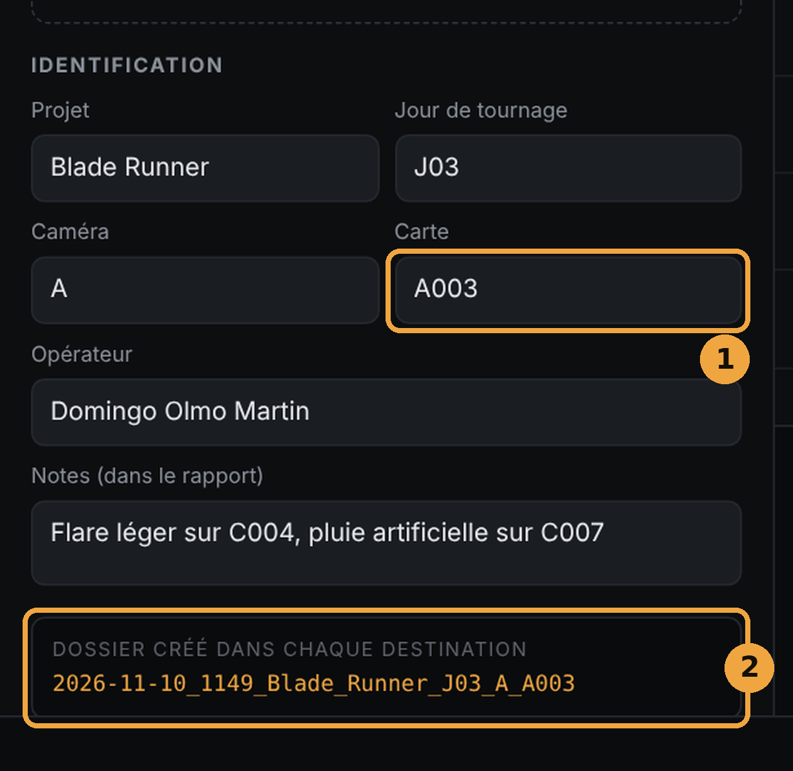</p>

Le numéro de carte (1) se déduit des noms de clips (par exemple `A003_C001…` donne la carte `A003` et la caméra `A`). Vérifiez-le quand même.

Sous ces champs (2), Bandua affiche en direct le nom du dossier qui sera créé dans **chaque** destination :

```
2026-11-10_1141_Blade_Runner_J03_A_A003
```

C'est-à-dire : date et heure du début, puis projet, jour, caméra et carte. Les champs vides sont simplement omis. Si un dossier du même nom existe déjà, Bandua ajoute `_2`, `_3`, etc., et n'écrase jamais rien.

### Étape 4 : régler la vérification (facultatif)

<p align="center">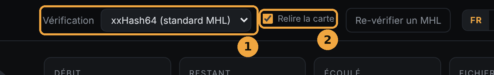</p>

- **Algorithme** (1) :
  - **xxHash64 (standard MHL)** : le choix par défaut, recommandé. Rapide, et reconnu par les logiciels de post-production.
  - **XXH3-64 (plus rapide)** : encore plus rapide sur les machines récentes.
  - **MD5** ou **SHA-1** : plus lents, à réserver aux cas où un labo ou une production les exige.
- **Relire la carte** (2) : Bandua lit la carte une seconde fois et compare les deux lectures. C'est plus lent, mais cela permet de repérer un lecteur de cartes, un câble ou une carte qui flanche. Gardez cette option cochée, sauf urgence réelle.

### Étape 5 : lancer

Le message en bas (1) résume l'opération, par exemple : *« Prêt : 103 Go vers 2 destination(s), vérification xxHash64. »* Cliquez sur **Lancer le déchargement** (2).

<p align="center">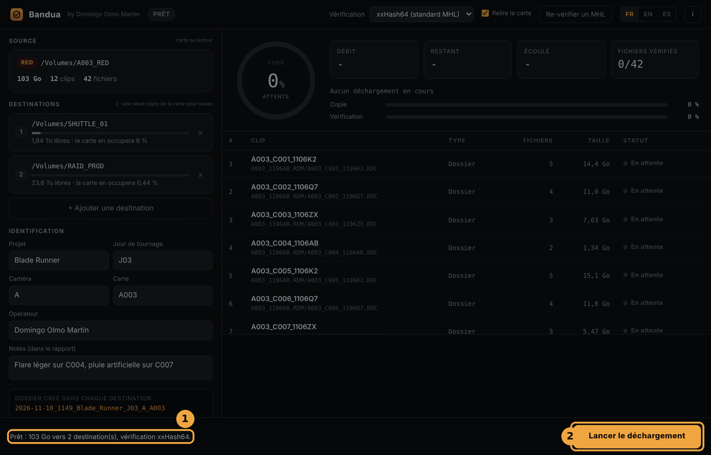</p>

Pendant le déchargement, **ne retirez ni la carte ni les disques**.

<p align="center">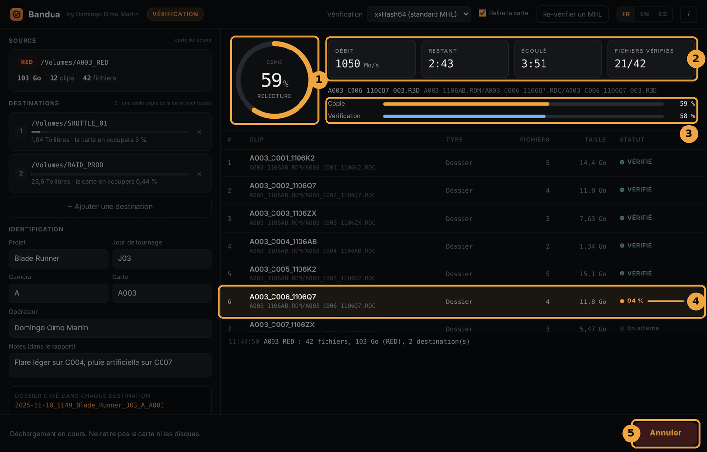</p>

1. Le **cercle** indique la part de la carte déjà copiée (comme la barre orange), avec un mot sous le pourcentage : *copie*, *relecture*, *vérification*, puis *patientez* pendant les derniers contrôles.
2. Les **compteurs** donnent le débit, le temps restant, le temps écoulé et le nombre de fichiers vérifiés.
3. Les **barres** suivent séparément la copie et la vérification.
4. Le **clip en cours** est surligné, avec sa propre progression. Chaque clip passe ensuite à **VÉRIFIÉ** (vert) ou **ERREUR** (rouge).
5. Le bouton devient **Annuler** (voir la section 8).

### Étape 6 : lire le résultat

<p align="center">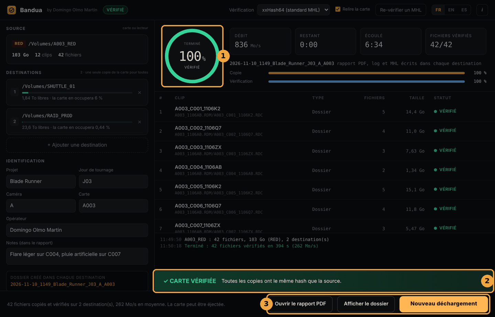</p>

**Tout est bon :**
1. le cercle passe au vert, avec la mention *vérifié* ; la pastille en haut indique *Vérifié* ;
2. le bandeau **✓ CARTE VÉRIFIÉE** s'affiche quelques secondes : toutes les copies ont le même hash que la source ;
3. trois boutons apparaissent : **Ouvrir le rapport PDF**, **Afficher le dossier** et **Nouveau déchargement**.

Le message du bas confirme le nombre de fichiers, de destinations et le débit moyen, puis indique que la carte peut être éjectée. Un clic sur une destination ouvre directement le dossier copié sur ce disque.

**Un problème est survenu :** le cercle passe au rouge et un bandeau **✕ ERREURS DÉTECTÉES** apparaît. Consultez le log et la liste des clips avant de toucher à la carte, et **ne la formatez pas**. Voir la section 8.

### Étape 7 : carte suivante

Cliquez sur **Nouveau déchargement**. Les destinations et les informations du projet (projet, jour, caméra, opérateur) sont conservées. Seuls la carte et les notes sont vidés. Il ne reste qu'à choisir la carte suivante.

## 5. Ce que Bandua fait pendant la copie

Ce qui suit se passe en arrière-plan, sans réglage de votre part. C'est ce qui permet de faire confiance au cercle vert.

1. **Copie sécurisée.** Chaque fichier est d'abord écrit sous un nom temporaire (`.bandua-part`). Il ne prend son vrai nom **qu'une fois vérifié**. Un fichier portant son nom définitif est donc un fichier contrôlé.
2. **Vérification sur le disque, pas en mémoire.** La copie est relue depuis le disque de destination en contournant le cache du système. C'est donc bien le disque qui est vérifié, et non une copie restée en mémoire vive. Si un volume refuse ce contournement, le log et le PDF le signalent.
3. **Taille contrôlée.** Un fichier trop court ou trop long est considéré comme une erreur.
4. **Double lecture de la carte** (si *Relire la carte* est cochée). Si les deux lectures diffèrent, les copies concernées sont marquées `.HASH_ERREUR`.
5. **Surveillance de la carte.** La taille et la date de chaque fichier sont contrôlées avant et après la copie, puis un nouvel inventaire complet de la carte est fait à la fin. Un fichier qui change, apparaît ou disparaît fait échouer le déchargement. Cela évite de formater une carte encore en cours d'écriture, ou modifiée par un autre logiciel.
6. **Copie à l'identique.** L'arborescence de la carte est respectée (structures RED `.RDM` / `.RDC`, ARRIRAW, MXF, ProRes, BRAW, etc.), et les dates de modification d'origine sont conservées.
7. **Fichiers système ignorés.** Les fichiers ajoutés par les ordinateurs (`.DS_Store`, `.Spotlight-V100`, `.Trashes`, `.fseventsd`, `System Volume Information`, `$RECYCLE.BIN`, `Thumbs.db`, `desktop.ini`, fichiers `._` de macOS) ne sont pas copiés.

## 6. Les rapports

Dans **chaque** dossier daté, sur **chaque** destination, Bandua écrit quatre fichiers, dans la langue de l'interface :

| Fichier | Usage |
|---|---|
| `<dossier>_rapport.pdf` (`_report.pdf` en anglais, `_informe.pdf` en espagnol) | Le document à transmettre : projet, carte, caméra, opérateur, notes, contrôles effectués, liste des clips avec leur statut, algorithme, résultat. |
| `<dossier>_log.txt` | Le journal détaillé, fichier par fichier, avec les hash. Utile en cas de doute ou de litige. |
| `<dossier>.mhl` | La liste des hash au format MHL 1.1, lisible par Silverstack, ShotPut Pro, Hedge… C'est ce fichier qui permet de re-vérifier le dossier plus tard. |
| `<dossier>.json` | Les mêmes informations dans un format exploitable par un script ou un autre logiciel. |

Dans le rapport, les clips sont regroupés par marque : un dossier `.RDC` RED compte pour un clip, un dossier ARRIRAW pour un clip, un `.braw` pour un clip, etc.

<p align="center">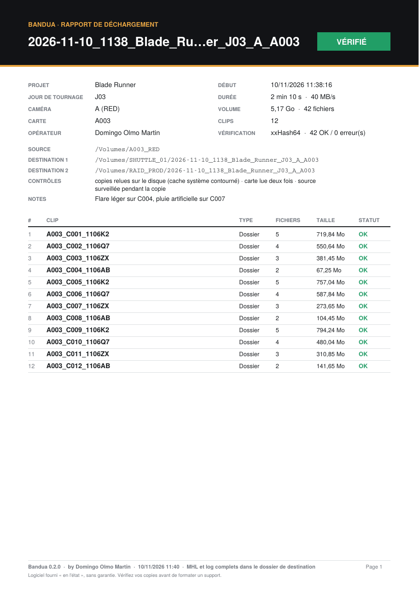</p>

## 7. Re-vérifier un dossier avec son MHL

Cette fonction sert à contrôler qu'un dossier déjà copié est toujours intact :
- avant de formater une carte, si la copie date un peu ;
- au moment de livrer un disque au monteur ou au labo ;
- à la réception d'un disque, ou après un transport.

**Procédure :**
1. Cliquez sur **Re-vérifier un MHL** dans la barre du haut.
2. Choisissez le fichier `.mhl` du dossier daté.
3. Bandua relit chaque fichier et le compare au hash enregistré dans le MHL. Vous retrouvez le même tableau de bord que pour un déchargement (progression, débit, statut de chaque clip). Vous pouvez annuler à tout moment.

<p align="center">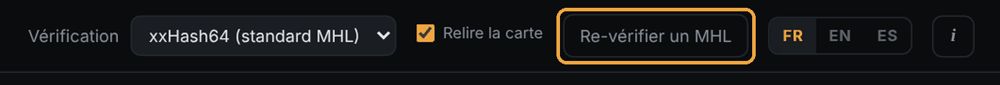</p>

**Statuts possibles :**
- **VÉRIFIÉ** : fichier identique au MHL ;
- **ABÎMÉ** : le hash diffère, le fichier a changé ou s'est corrompu ;
- **MANQUANT** : le fichier listé dans le MHL n'existe plus.

**Résultat :**
- **✓ DOSSIER INTACT** : tous les fichiers sont identiques au MHL ;
- sinon, le clip en cause est marqué (1) et un bandeau rouge (2) indique le nombre de fichiers manquants et abîmés, avec un rappel : ne formatez pas la carte d'origine.

<p align="center">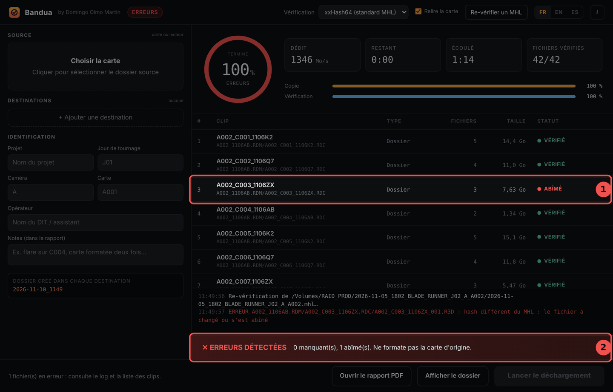</p>

Les fichiers présents dans le dossier mais **absents du MHL** (ajoutés après coup) sont signalés dans le log, mais ne sont pas vérifiés.

Bandua écrit à côté du MHL un rapport PDF et un log de re-vérification, horodatés, par exemple `<dossier>_reverification_2026-11-10_143012.pdf`. Le MHL d'origine n'est jamais modifié.

### Contrôler un MHL avec Bandua MHL Companion

Les personnes qui reçoivent les rushes (monteur, assistant de montage, labo, production) n'ont pas besoin de Bandua pour contrôler un MHL. Elles peuvent utiliser **[Bandua MHL Companion](https://github.com/tetsujin28/bandua-mhl-companion)**, une application gratuite, plus simple, conçue uniquement pour cela.

Il suffit de déposer le dossier des rushes sur sa fenêtre : elle trouve tous les MHL qu'il contient, relit chaque fichier et le compare au hash enregistré. Elle indique clairement si les rushes sont intacts ou quel clip pose problème, et peut exporter un rapport texte à renvoyer à la production ou au DIT. Elle lit les MHL de Bandua, mais aussi ceux de Silverstack, ShotPut Pro, Hedge et des autres logiciels (MHL 1.1 et ASC MHL). Elle est en lecture seule : elle ne copie rien et ne modifie aucun fichier.

Bandua MHL Companion est disponible pour Windows et macOS sur la [page des Releases](https://github.com/tetsujin28/bandua-mhl-companion/releases) de son dépôt GitHub.

## 8. Annulation et erreurs

### Annuler

Cliquez sur **Annuler**, puis sur **Confirmer l'annulation** dans les trois secondes (deux clics, pour éviter une annulation accidentelle). Bandua s'arrête proprement et ne laisse aucun fichier `.bandua-part` derrière lui. Le bandeau **✕ ANNULÉ** rappelle de ne pas formater la carte.

### En cas d'erreur

| Ce que vous voyez | Ce que cela veut dire | Que faire |
|---|---|---|
| Clip en **ERREUR**, fichier `.HASH_ERREUR` sur la destination | La copie ne correspond pas à la source, ou les deux lectures de la carte diffèrent. | Lire le log. Essayer un autre lecteur ou un autre câble, puis **Relancer cette carte**. |
| « La carte a changé pendant le déchargement » | Un fichier a été modifié, ajouté ou supprimé sur la carte pendant l'opération. | Ne pas formater. Vérifier qu'aucun autre logiciel n'accède à la carte, puis relancer. |
| **ESPACE INSUFFISANT** sur une destination | La carte ne rentre pas sur ce disque. | Libérer de la place ou choisir un autre disque. Bandua refuse de démarrer tant que le problème n'est pas réglé. |
| « Lecture impossible » sur la source | La carte ou le lecteur ne répond pas. | Réinsérer la carte, changer de lecteur. |

Le bouton **Relancer cette carte** reprend la même carte avec les mêmes réglages. Un nouveau dossier est créé (avec un suffixe `_2` si nécessaire), et les copies défectueuses restent identifiables par leur extension `.HASH_ERREUR`.

## 9. Bonnes pratiques de plateau

- **Toujours deux copies minimum**, sur deux disques physiquement différents.
- **Attendre le cercle vert et la mention « Vérifié »** avant d'éjecter, et a fortiori avant de formater.
- **Formater la carte dans la caméra**, jamais sur l'ordinateur.
- **Garder « Relire la carte » cochée** : la plupart des pertes viennent d'un lecteur ou d'un câble défaillant, pas de la carte elle-même.
- **Remplir les notes** : incidents, carte formatée deux fois, clip coupé… Le monteur vous en sera reconnaissant.
- **Re-vérifier avec le MHL** avant de livrer un disque.
- **Ne lancer aucun autre logiciel** sur la carte pendant le déchargement (navigateur de médias, logiciel de montage…).

## 10. Questions fréquentes

**Combien de temps cela prend-il ?**
Le temps de lecture de la carte, plus la vérification. Avec « Relire la carte », comptez à peu près une lecture de carte de plus. Le facteur limitant est généralement le lecteur de cartes ou le disque le plus lent.

**Puis-je utiliser Bandua avec une caméra non listée ?**
Oui. Toute carte est copiée intégralement. Seul le regroupement en clips du rapport sera plus sommaire (« Générique »).

**Mon monteur utilise Silverstack, ShotPut ou Hedge. Peut-il lire mes MHL ?**
Oui, le MHL 1.1 avec xxHash64 est le standard que ces logiciels lisent. Il peut aussi utiliser Bandua MHL Companion, gratuit.

**Bandua fonctionne-t-il sous Linux ?**
Pas pour l'instant. Le code reste compatible, mais la version Linux n'est pas proposée tant qu'elle ne peut pas être testée.

**Bandua envoie-t-il des données sur Internet ?**
Non. Tout se passe sur votre ordinateur.

## 11. Avertissement et licence

Bandua est un outil d'aide à la copie et à la vérification de médias. Il ne remplace pas vos propres contrôles ni vos procédures de sauvegarde. Le logiciel est fourni « en l'état », sans aucune garantie. L'auteur ne saurait être tenu responsable de toute perte, corruption ou suppression de données, rushes ou supports, ni de tout dommage direct ou indirect résultant de l'utilisation, d'une mauvaise utilisation ou d'un dysfonctionnement du logiciel.

**Ne formatez ni ne réutilisez jamais une carte avant d'avoir vérifié que chaque copie est complète et lisible.**

© 2026 Domingo Olmo Martin. Distribué sous [licence MIT](../LICENSE).
