<p align="center">
  
</p>

<h1 align="center">Bandua user guide</h1>
<p align="center"><b>Version 0.2.0 (beta) · Windows and macOS</b></p>
<p align="center">
  <b>English</b> · <a href="GUIDE.fr.md">Français</a> · <a href="GUIDE.es.md">Español</a>
</p>

## Contents

1. [Overview](#1-overview)
2. [Installation](#2-installation)
3. [The interface at a glance](#3-the-interface-at-a-glance)
4. [Offloading a card, step by step](#4-offloading-a-card-step-by-step)
5. [What Bandua does during the copy](#5-what-bandua-does-during-the-copy)
6. [Reports](#6-reports)
7. [Re-verifying a folder from its MHL](#7-re-verifying-a-folder-from-its-mhl)
8. [Cancelling and errors](#8-cancelling-and-errors)
9. [Good practice on set](#9-good-practice-on-set)
10. [FAQ](#10-faq)
11. [Disclaimer and license](#11-disclaimer-and-license)

## 1. Overview

Bandua offloads your camera cards to one or more drives at the same time. It checks every copy against the source with a hash. It then writes a PDF report, a log, an MHL file and a JSON file, to hand over to the editor, the production or the lab.

The rule is simple: **never format a card on the strength of a progress bar.** Bandua only calls a card "verified" once every file has been read back from every destination drive and compared with the original.

Bandua is free, open source (MIT License), and needs no account or license key.

## 2. Installation

### Download

The files are on the [Releases page](https://github.com/tetsujin28/bandua/releases):

| System | File |
|---|---|
| Windows, no install | `Bandua_x.y.z_portable.exe` |
| Windows, installer | `Bandua_x.y.z_x64-setup.exe` or `.msi` |
| macOS (Intel and Apple Silicon) | `Bandua_x.y.z_universal.dmg` |

### First launch

The app is not signed yet, so your system shows a warning, only once:

- **Windows**: click "More info", then "Run anyway".
- **macOS**: right-click the app, choose "Open", then confirm.

Your browser may also flag the download as unusual. This is common for a new, unsigned app. Keep the file from the downloads panel. If in doubt, have it scanned on [VirusTotal](https://www.virustotal.com).

### Welcome window

On first launch, Bandua shows a disclaimer (1). Read it, then click **I understand and accept** (2). You can find it again under **About** (the *i* button).

<p align="center">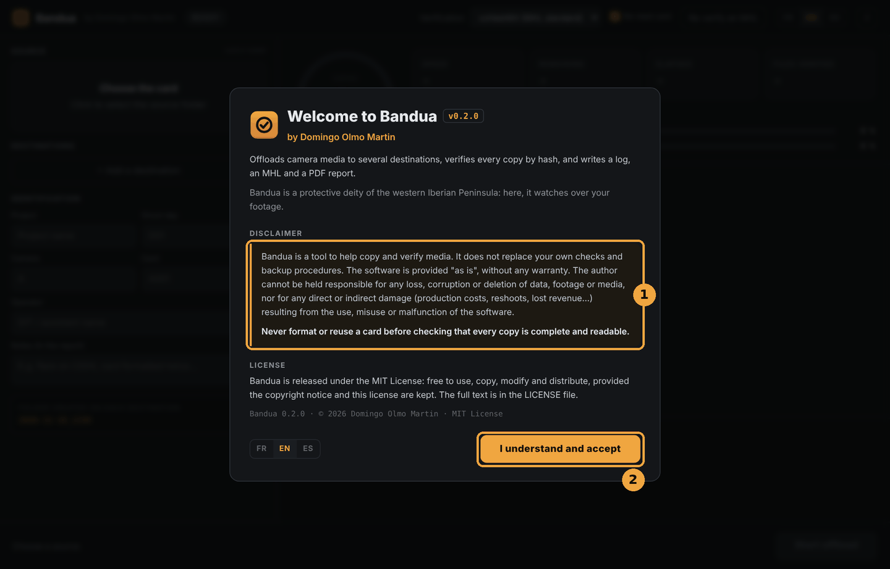</p>

## 3. The interface at a glance

<p align="center">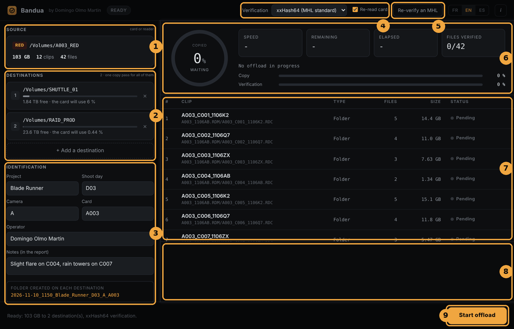</p>

1. **Source**: the card to offload, with its brand, size, number of clips and files.
2. **Destinations**: the drives that will receive a copy, with their free space.
3. **Identification**: project, shoot day, camera, card, operator, notes, and a preview of the name of the folder that will be created.
4. **Verification**: the hash algorithm and the **Re-read card** checkbox.
5. **Re-verify an MHL**: checks a folder that has already been copied (see section 7).
6. **Dashboard**: the progress ring, the counters (*Speed*, *Remaining*, *Elapsed*, *Files verified*), the current file and the copy and verification bars.
7. **Clip list** of the card, with the status of each clip.
8. **Log**: the live journal.
9. **Main button**: **Start offload**, then **Cancel**, then **New offload** or **Retry this card**. A message on its left sums up the current state.

At the top, the badge next to the app name shows the state: *Ready*, *Copying*, *Verifying*, *Verified*, *Errors*, *Cancelled*. The **FR / EN / ES** buttons switch the interface language instantly.

## 4. Offloading a card, step by step

### Step 1: choose the source

Click the **Source** box ("Choose the card") and select the card, or the folder that stands for it.

<p align="center">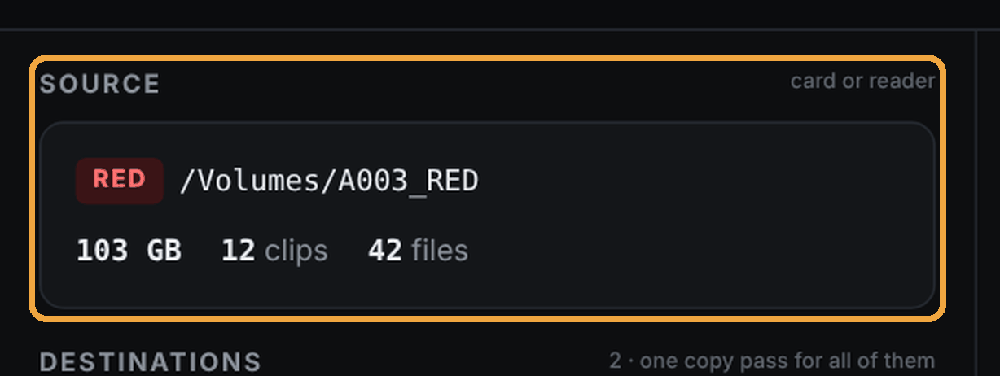</p>

Bandua scans the card and shows:
- the recognised brand (RED, ARRI, Blackmagic, Sony, Canon, GoPro, DJI, or "Générique" for anything else);
- the number of clips and files, and the total size;
- the clip list in the table on the right, marked *Pending*.

If no video clip is recognised, Bandua says so, but **still copies every file** on the card.

### Step 2: add the destinations

Click **+ Add a destination** (2) and pick a folder on your first drive. Repeat for every copy you need (usually two drives, sometimes three).

<p align="center">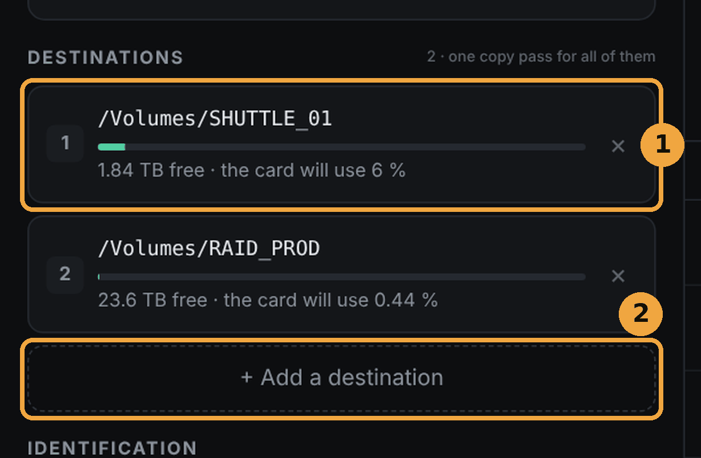</p>

For each destination (1), Bandua shows:
- the free space and the share the card will take;
- a green gauge, which turns red with **NOT ENOUGH SPACE** if the card does not fit.

The card is read **only once** to feed every destination, so adding drives does not multiply the card read time.

To remove a destination, click the cross on its right. Bandua refuses a destination that is the source itself, or a folder already chosen.

### Step 3: identify the card

Fill in the **Identification** section:

| Field | Example | Note |
|---|---|---|
| Project | Blade Runner | kept from one session to the next |
| Shoot day | D03 | kept |
| Camera | A | kept; filled in automatically if empty |
| Card | A003 | filled in automatically from the clip names |
| Operator | name of the DIT or assistant | kept |
| Notes | "Slight flare on C004, rain towers on C007" | shown in the report |

<p align="center">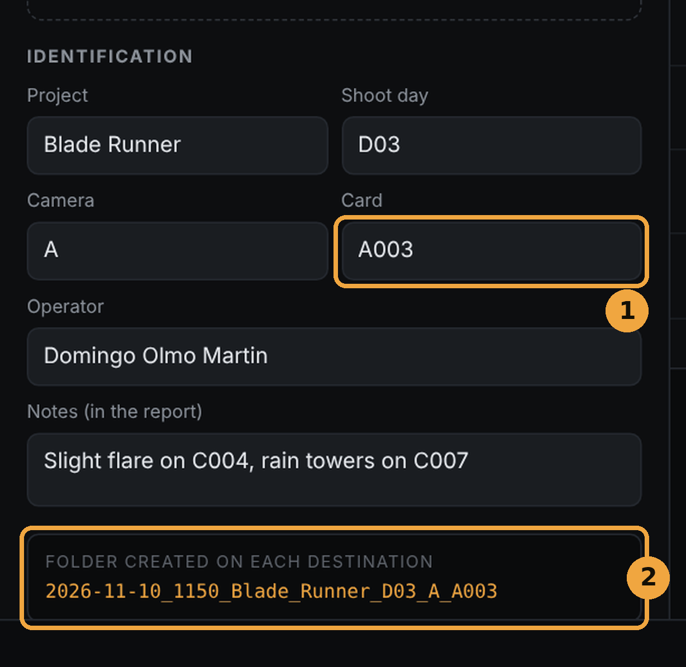</p>

The card number (1) comes from the clip names (for example `A003_C001…` gives card `A003` and camera `A`). Check it anyway.

Below these fields (2), Bandua shows live the name of the folder that will be created on **each** destination:

```
2026-11-10_1142_Blade_Runner_D03_A_A003
```

That is: date and start time, then project, day, camera and card. Empty fields are simply left out. If a folder with the same name already exists, Bandua adds `_2`, `_3` and so on, and never overwrites anything.

### Step 4: set the verification (optional)

<p align="center">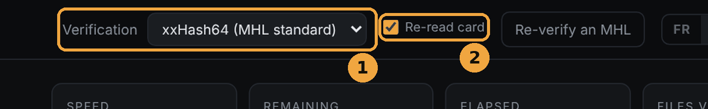</p>

- **Algorithm** (1):
  - **xxHash64 (MHL standard)**: the default and recommended choice. Fast, and understood by post-production software.
  - **XXH3-64 (faster)**: even faster on recent machines.
  - **MD5** or **SHA-1**: slower, only when a lab or a production asks for them.
- **Re-read card** (2): Bandua reads the card a second time and compares both reads. It is slower, but it catches a failing card reader, cable or card. Keep it ticked unless you are really in a hurry.

### Step 5: start

The message at the bottom (1) sums up the job, for example: *"Ready: 103 GB to 2 destination(s), xxHash64 verification."* Click **Start offload** (2).

<p align="center">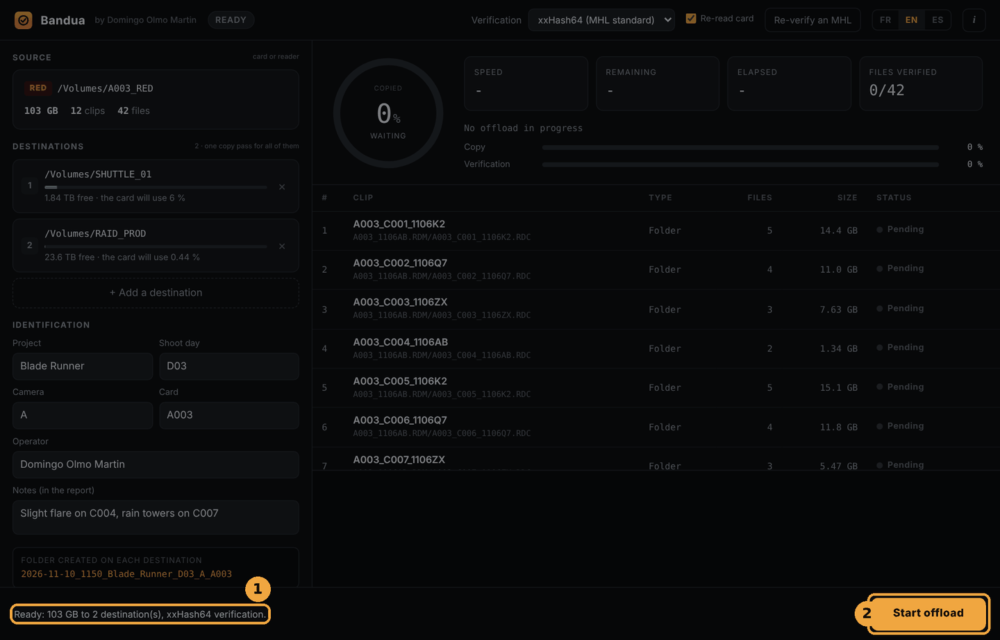</p>

During the offload, **do not remove the card or the drives**.

<p align="center">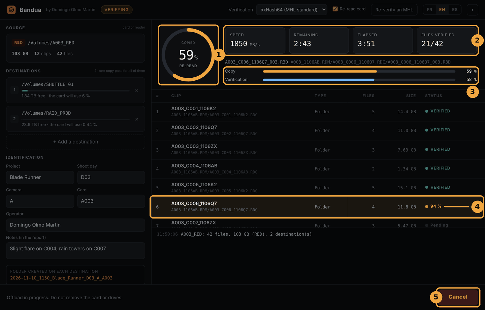</p>

1. The **ring** shows how much of the card has been copied (like the orange bar), with a word under the percentage: *copy*, *re-read*, *verify*, then *wait* during the final checks.
2. The **counters** show speed, time remaining, time elapsed and the number of verified files.
3. The **bars** track copy and verification separately.
4. The **current clip** is highlighted, with its own progress. Each clip then turns **VERIFIED** (green) or **ERROR** (red).
5. The button becomes **Cancel** (see section 8).

### Step 6: read the result

<p align="center">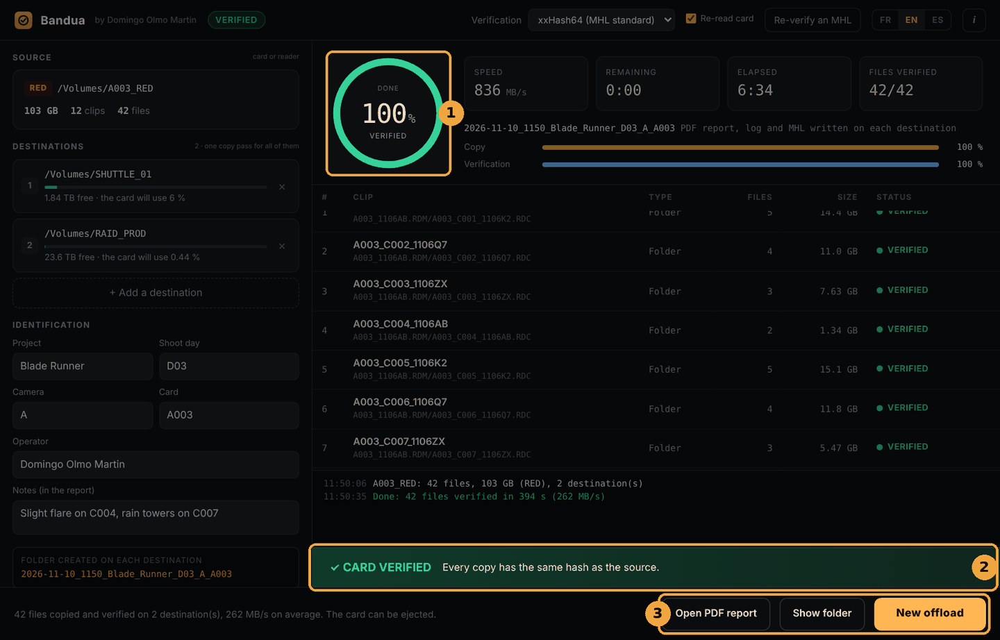</p>

**All good:**
1. the ring turns green and reads *verified*; the badge at the top reads *Verified*;
2. the **✓ CARD VERIFIED** banner shows for a few seconds: every copy has the same hash as the source;
3. three buttons appear: **Open PDF report**, **Show folder** and **New offload**.

The message at the bottom confirms the number of files and destinations and the average speed, then says the card can be ejected. Clicking a destination opens the copied folder on that drive.

**Something went wrong:** the ring turns red and a **✕ ERRORS DETECTED** banner appears. Read the log and the clip list before touching the card, and **do not format it**. See section 8.

### Step 7: next card

Click **New offload**. The destinations and the project info (project, day, camera, operator) are kept. Only the card and the notes are cleared. Just choose the next card.

## 5. What Bandua does during the copy

All of this happens in the background, with nothing for you to set. It is what makes the green ring worth trusting.

1. **Safe copy.** Each file is first written under a temporary name (`.bandua-part`). It only gets its real name **once verified**. A file with its final name is therefore a checked file.
2. **Verification on the drive, not in memory.** The copy is read back from the destination drive with the system cache bypassed. It really is the drive that gets checked, not a copy still sitting in RAM. If a volume refuses the bypass, the log and the PDF say so.
3. **Size checked.** A file that is too short or too long counts as an error.
4. **Card read twice** (if *Re-read card* is ticked). If the two reads differ, the copies concerned are marked `.HASH_ERREUR`.
5. **Card watched.** The size and date of every file are checked before and after its copy, then the whole card is listed again at the end. A file that changes, appears or disappears fails the offload. This stops you formatting a card that was still being written to, or changed by another program.
6. **Exact copy.** The card's folder structure is kept as is (RED `.RDM` / `.RDC`, ARRIRAW, MXF, ProRes, BRAW and so on), and the original modification dates are preserved.
7. **System files skipped.** Files added by computers (`.DS_Store`, `.Spotlight-V100`, `.Trashes`, `.fseventsd`, `System Volume Information`, `$RECYCLE.BIN`, `Thumbs.db`, `desktop.ini`, macOS `._` files) are not copied.

## 6. Reports

In **each** dated folder, on **each** destination, Bandua writes four files, in the interface language:

| File | Use |
|---|---|
| `<folder>_report.pdf` (`_rapport.pdf` in French, `_informe.pdf` in Spanish) | The document to hand over: project, card, camera, operator, notes, checks performed, clip list with status, algorithm, result. |
| `<folder>_log.txt` | The detailed journal, file by file, with hashes. Useful when in doubt or in a dispute. |
| `<folder>.mhl` | The list of hashes in MHL 1.1 format, readable by Silverstack, ShotPut Pro, Hedge… This is the file that lets you re-verify the folder later. |
| `<folder>.json` | The same information in a format a script or another program can use. |

In the report, clips are grouped by brand: a RED `.RDC` folder counts as one clip, an ARRIRAW folder as one clip, a `.braw` as one clip, and so on.

<p align="center">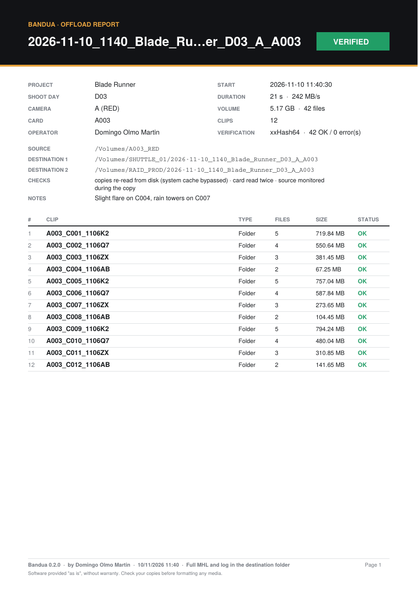</p>

## 7. Re-verifying a folder from its MHL

This checks that a folder you copied earlier is still intact:
- before formatting a card, if the copy is not fresh;
- when you deliver a drive to the editor or the lab;
- when a drive arrives, or after it has been shipped.

**How to:**
1. Click **Re-verify an MHL** in the top bar.
2. Choose the `.mhl` file of the dated folder.
3. Bandua reads every file back and compares it with the hash stored in the MHL. You get the same dashboard as for an offload (progress, speed, status of each clip). You can cancel at any time.

<p align="center">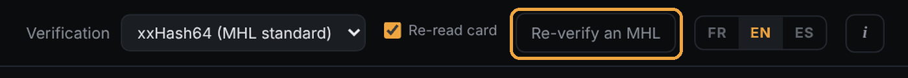</p>

**Possible statuses:**
- **VERIFIED**: the file matches the MHL;
- **DAMAGED**: the hash differs, the file has changed or is corrupted;
- **MISSING**: the file listed in the MHL no longer exists.

**Result:**
- **✓ FOLDER INTACT**: every file matches the MHL;
- otherwise, the clip at fault is marked (1) and a red banner (2) gives the number of missing and damaged files, with a reminder: do not format the original card.

<p align="center">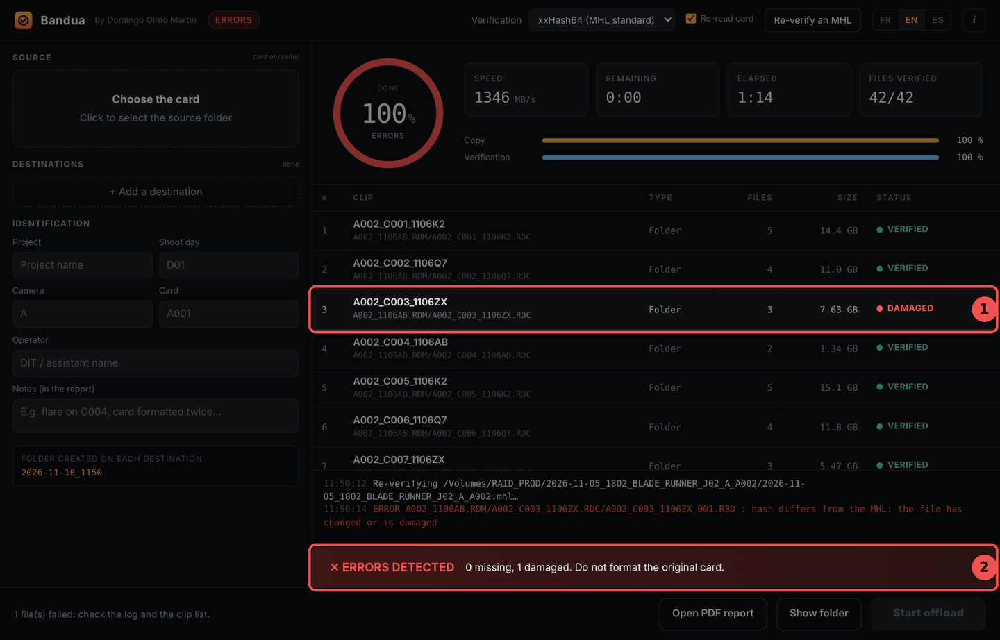</p>

Files that are in the folder but **not in the MHL** (added later) are listed in the log, but not verified.

Bandua writes a time-stamped re-verification PDF report and log next to the MHL, for example `<folder>_reverification_2026-11-10_143012.pdf`. The original MHL is never changed.

### Checking an MHL with Bandua MHL Companion

People who receive the footage (editor, assistant editor, lab, production) do not need Bandua to check an MHL. They can use **[Bandua MHL Companion](https://github.com/tetsujin28/bandua-mhl-companion)**, a free and simpler app made only for that.

Just drop the footage folder on its window: it finds every MHL inside, reads every file back and compares it with the stored hash. It tells you clearly whether the footage is intact or which clip has a problem, and can export a text report to send back to the production or the DIT. It reads Bandua's MHL files, and also those written by Silverstack, ShotPut Pro, Hedge and other tools (MHL 1.1 and ASC MHL). It is read-only: it copies nothing and changes no file.

Bandua MHL Companion is available for Windows and macOS on the [Releases page](https://github.com/tetsujin28/bandua-mhl-companion/releases) of its GitHub repository.

## 8. Cancelling and errors

### Cancelling

Click **Cancel**, then **Confirm cancel** within three seconds (two clicks, to avoid cancelling by accident). Bandua stops cleanly and leaves no `.bandua-part` file behind. The **✕ CANCELLED** banner reminds you not to format the card.

### When something goes wrong

| What you see | What it means | What to do |
|---|---|---|
| Clip in **ERROR**, `.HASH_ERREUR` file on the destination | The copy does not match the source, or the two card reads differ. | Read the log. Try another reader or cable, then **Retry this card**. |
| "The card changed during the offload" | A file was changed, added or deleted on the card during the job. | Do not format. Make sure no other program is using the card, then run it again. |
| **NOT ENOUGH SPACE** on a destination | The card does not fit on that drive. | Free up space or choose another drive. Bandua will not start until this is fixed. |
| "Cannot read" on the source | The card or the reader is not responding. | Reinsert the card, change readers. |

**Retry this card** runs the same card again with the same settings. A new folder is created (with a `_2` suffix if needed), and faulty copies stay easy to spot thanks to their `.HASH_ERREUR` extension.

## 9. Good practice on set

- **Always at least two copies**, on two physically separate drives.
- **Wait for the green ring and "Verified"** before ejecting, let alone formatting.
- **Format the card in the camera**, never on the computer.
- **Keep "Re-read card" ticked**: most losses come from a faulty reader or cable, not from the card itself.
- **Fill in the notes**: incidents, card formatted twice, clip cut short… The editor will thank you.
- **Re-verify from the MHL** before delivering a drive.
- **Do not open the card in any other program** during the offload (media browser, editing software…).

## 10. FAQ

**How long does it take?**
The time to read the card, plus verification. With "Re-read card", count roughly one more card read. The bottleneck is usually the card reader or the slowest drive.

**Can I use Bandua with a camera that is not listed?**
Yes. Every card is copied in full. Only the clip grouping in the report will be simpler (labelled "Générique").

**My editor uses Silverstack, ShotPut or Hedge. Can they read my MHL files?**
Yes, MHL 1.1 with xxHash64 is the standard these tools read. They can also use the free Bandua MHL Companion.

**Does Bandua run on Linux?**
Not for now. The code stays compatible, but there is no Linux build until it can be tested.

**Does Bandua send data over the Internet?**
No. Everything happens on your computer.

## 11. Disclaimer and license

Bandua is a tool to help copy and verify media. It does not replace your own checks or backup procedures. The software is provided "as is", without any warranty. The author cannot be held responsible for any loss, corruption or deletion of data, footage or media, nor for any direct or indirect damage resulting from the use, misuse or malfunction of the software.

**Never format or reuse a card before checking that every copy is complete and readable.**

© 2026 Domingo Olmo Martin. Released under the [MIT License](../LICENSE).
